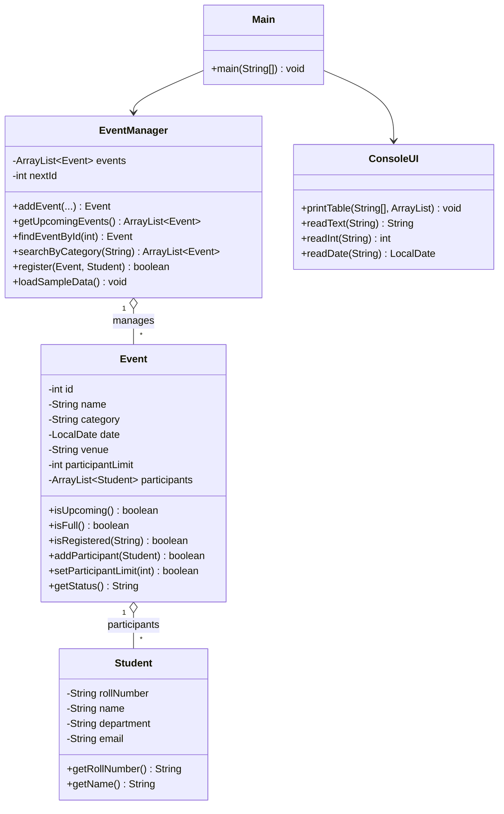

# 🎓 College Event Registration System


A menu-driven **Java console application** where students can explore upcoming college events and register for them, and where an admin can manage events and participant limits.

---

## 📑 Table of Contents

- [About the Project](#-about-the-project)
- [Features](#-features)
- [Java Concepts Used](#-java-concepts-used)
- [Project Structure](#-project-structure)
- [Class Diagram](#-class-diagram)
- [Web Frontend](#-web-frontend)
- [How to Run](#-how-to-run)
- [Sample Output](#-sample-output)
- [Validation Rules](#-validation-rules)
- [Future Enhancements](#-future-enhancements)

---

## 📌 About the Project

Colleges host many events (hackathons, workshops, fests, sports meets), and keeping track of who registered for what is often done by hand. This project is a simple **event registration portal** that:

- lists all upcoming events with their available seats,
- lets students register using their roll number,
- stops registrations once an event is full, and
- lets an admin view participants, add events and change seat limits.

All data is kept in memory using `ArrayList`s, and 7 sample events are loaded at start-up.

---

## ✨ Features

| # | Feature | Who | Description |
|---|---------|-----|-------------|
| 1 | **Display upcoming events** | Student | Shows all events from today onwards in a table with seats and status |
| 2 | **Register for events** | Student | Registers a student by roll number, name, department and email |
| 3 | **View registered participants** | Student / Admin | Lists every student registered for a chosen event |
| 4 | **Search events by category** | Student | Finds events by category (Technical, Cultural, Sports, Seminar...) |
| 5 | **Set participant limits** | Admin 🔒 | Changes the maximum number of participants for an event |
| 6 | **Add new event** | Admin 🔒 | Creates a new event with name, category, venue, date and limit |

> 🔑 Admin password: `admin123`

Each event shows one of three statuses:

| Status | Meaning |
|--------|---------|
| `OPEN` | Event is upcoming and has free seats |
| `FULL` | Participant limit reached |
| `CLOSED` | Event date has already passed |

---

## 🧠 Java Concepts Used

| Concept | Where it is used |
|---------|------------------|
| **Classes** | `Student`, `Event`, `EventManager`, `ConsoleUI`, `Main` |
| **Objects** | Each event and each student is an object, e.g. `new Student(roll, name, dept, email)` |
| **ArrayList** | `ArrayList<Event>` stores all events; `ArrayList<Student>` stores participants of each event |
| **Conditional statements** | `if / else if / else` for registration checks and limits; `switch` for the main menu |
| **Encapsulation** | All fields are `private` and accessed through getters |
| **Packages** | Code is organised into `model`, `service` and `ui` packages |
| **Exception handling** | `try / catch` for invalid numbers and dates |

Example: conditional checks before registering a student

```java
if (event == null) {
    ConsoleUI.error("No event found with ID " + eventId + ".");
} else if (!event.isUpcoming()) {
    ConsoleUI.error("Registration closed: \"" + event.getName() + "\" has already happened.");
} else if (event.isFull()) {
    ConsoleUI.error("Sorry, \"" + event.getName() + "\" is full.");
}
```

---

## 📁 Project Structure

```
College-Event-Registration-System/
│
├── src/
│   ├── Main.java                 # Entry point – menu and user flow
│   │
│   ├── model/
│   │   ├── Event.java            # Event details + ArrayList of participants
│   │   └── Student.java          # Student details
│   │
│   ├── service/
│   │   └── EventManager.java     # Stores events, search & registration logic
│   │
│   └── ui/
│       └── ConsoleUI.java        # Tables, headings, messages and input reading
│
├── frontend/                     # Web portal (plain HTML + CSS)
│   ├── index.html                # Home: hero, stats, upcoming events, categories
│   ├── events.html               # All events + category filter
│   ├── register.html             # Registration form
│   ├── registered.html           # Registration success page
│   ├── participants.html         # Participant list for every event
│   ├── admin.html                # Set participant limit / add event
│   └── css/
│       └── style.css             # All styles (responsive, no frameworks)
│
├── run.bat                       # Compile & run on Windows
├── run.sh                        # Compile & run on Linux / macOS
└── README.md
```

---

## 🗺 Class Diagram



---

## 🌐 Web Frontend

The `frontend/` folder contains a web version of the portal built with **only HTML and CSS** (no JavaScript, no frameworks). It uses the same events as the Java app.

| Page | Feature |
|------|---------|
| `index.html` | Home page with stats, the next 3 events and category shortcuts |
| `events.html` | Event cards with seats left, progress bar and `OPEN` / `FULL` / `CLOSED` status |
| `register.html` | Registration form with built-in HTML validation |
| `participants.html` | Overview table + participant list for each event |
| `admin.html` | Set participant limit and add a new event |

**How it works without JavaScript**

- **Search by category**: the filter chips link to `#technical`, `#cultural`, ... and the CSS `:target` selector hides cards from other categories. Category tiles on the home page link straight to a filtered view (e.g. `events.html#sports`).
- **Form validation**: `required`, `type="email"`, `pattern` (roll number `22CS101`, 10-digit phone), `min` for limits and dates. Full and closed events are `disabled` in the dropdown.
- **Success messages**: forms submit to `registered.html` or to `admin.html#limit-updated`, where a hidden alert is shown with `:target`.
- **Mobile menu**: a hidden checkbox toggles the navigation links.
- **Responsive layout**: CSS Grid, Flexbox and media queries.

**Open it**: double-click `frontend/index.html`, or use the *Live Server* extension in VS Code.

> The frontend is a static design. Data on the pages is sample data and form submissions are not saved. Connecting it to the Java code would need a backend (e.g. Java `HttpServer` or Spring Boot).

---

## ▶️ How to Run

### Prerequisites
- **JDK 11 or newer** installed ([download Temurin](https://adoptium.net/))
- Check with: `java -version`

### Option 1: Run script

**Windows**
```bat
run.bat
```

**Linux / macOS**
```bash
chmod +x run.sh
./run.sh
```

### Option 2: Manual commands

```bash
javac -d out src/Main.java src/model/*.java src/service/*.java src/ui/*.java
java -cp out Main
```

### Option 3: VS Code / IntelliJ
Open the project folder and run `Main.java`.

---

## 🖥 Sample Output

**Start-up and main menu**
```
============================================================
             COLLEGE EVENT REGISTRATION PORTAL
            Explore  |  Register  |  Participate
============================================================

------------------------------------------------------------
                         MAIN MENU
------------------------------------------------------------
  1. Display upcoming events
  2. Register for an event
  3. View registered participants
  4. Search events by category
  5. Set participant limit   (admin)
  6. Add a new event         (admin)
  0. Exit
```

**1. Display upcoming events**
```
+----+-----------------------+-----------+------------+-------------------+-------+--------+
| ID | Event                 | Category  | Date       | Venue             | Seats | Status |
+----+-----------------------+-----------+------------+-------------------+-------+--------+
| 1  | CodeSprint Hackathon  | Technical | 2026-11-06 | CSE Lab Block     | 0/50  | OPEN   |
| 2  | Robotics Workshop     | Technical | 2026-11-13 | Mech Seminar Hall | 0/30  | OPEN   |
| 3  | Annual Cultural Fest  | Cultural  | 2026-11-21 | Main Auditorium   | 0/200 | OPEN   |
| 4  | Classical Dance Night | Cultural  | 2026-11-09 | Open Air Theatre  | 3/3   | FULL   |
| 5  | Inter-College Cricket | Sports    | 2026-11-16 | College Ground    | 0/22  | OPEN   |
| 6  | Startup Pitch Day     | Seminar   | 2026-11-04 | Conference Hall   | 0/40  | OPEN   |
+----+-----------------------+-----------+------------+-------------------+-------+--------+
```

**2. Register for an event**
```
  > Event ID to register for: 1
  > Roll number : 22CS101
  > Full name   : Ravi Kumar
  > Department  : CSE
  > Email       : ravi@cbit.ac.in
  [OK] Registered Ravi Kumar for "CodeSprint Hackathon".
  [i]  Seats left: 49
```

**Registration blocked (full / duplicate / past event)**
```
  [X]  Sorry, "Classical Dance Night" is full (3/3).
  [X]  Roll number 22cs101 is already registered for "CodeSprint Hackathon".
  [X]  Registration closed: "Freshers Quiz" has already happened.
```

**3. View registered participants**
```
------------------------------------------------------------
            PARTICIPANTS - CLASSICAL DANCE NIGHT
------------------------------------------------------------
+-----+---------+-------------+------------+------------------+
| No. | Roll No | Name        | Department | Email            |
+-----+---------+-------------+------------+------------------+
| 1   | 22CS101 | Ravi Kumar  | CSE        | ravi@cbit.ac.in  |
| 2   | 22EC045 | Sneha Reddy | ECE        | sneha@cbit.ac.in |
| 3   | 22IT012 | Arjun Varma | IT         | arjun@cbit.ac.in |
+-----+---------+-------------+------------+------------------+
  [i]  Registered: 3 / 3
```

**4. Search events by category**
```
  [i]  Available categories: Technical, Cultural, Sports, Seminar
  > Category: technical
+----+----------------------+-----------+------------+-------------------+-------+--------+
| ID | Event                | Category  | Date       | Venue             | Seats | Status |
+----+----------------------+-----------+------------+-------------------+-------+--------+
| 1  | CodeSprint Hackathon | Technical | 2026-11-06 | CSE Lab Block     | 0/50  | OPEN   |
| 2  | Robotics Workshop    | Technical | 2026-11-13 | Mech Seminar Hall | 0/30  | OPEN   |
| 7  | Freshers Quiz        | Technical | 2026-10-22 | Library Hall      | 0/60  | CLOSED |
+----+----------------------+-----------+------------+-------------------+-------+--------+
```

**5. Set participant limit (admin)**
```
  > Admin password: admin123
  > Event ID: 4
  [i]  Current limit: 3  |  Registered: 3
  > New limit: 10
  [OK] Limit for "Classical Dance Night" updated to 10.
```

> Event dates are generated relative to the current day, so they will differ when you run it.

---

## ✅ Validation Rules

- ❌ Cannot register for an event that is **full**
- ❌ Cannot register for an event whose **date has passed**
- ❌ Same **roll number** cannot register twice for one event (case-insensitive)
- ❌ Email must contain `@` and `.`
- ❌ Participant limit cannot be **less than 1** or **lower than the current number of registrations**
- ❌ New events cannot be scheduled in the **past**
- ❌ Admin options require the **admin password**
- ❌ Non-numeric or invalid menu choices are rejected and asked again

---

## 🚀 Future Enhancements

- Save events and registrations to a file or database (MySQL / JDBC)
- Cancel a registration
- Separate student and admin login accounts
- Export the participant list to CSV
- Connect the HTML/CSS frontend to the Java code through a backend (Spring Boot / `HttpServer`)

---

## 👨‍💻 Author

**Your Name**: B.Tech, CBIT
